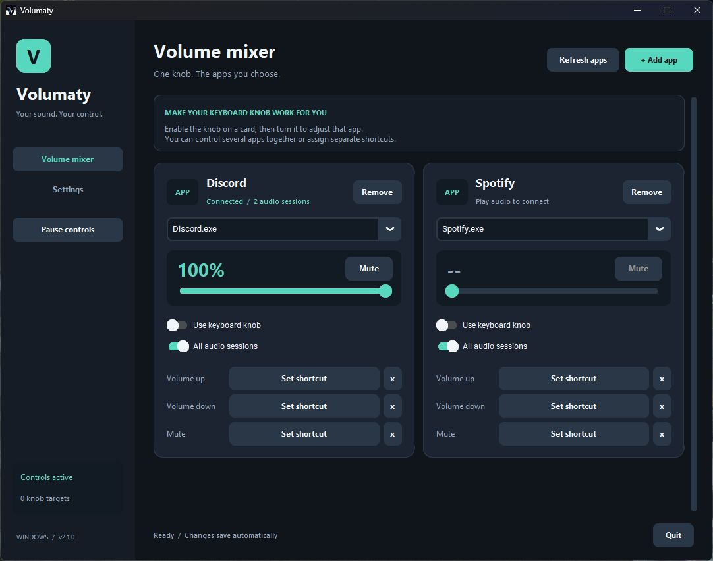

<div align="center">

# Volumaty

**Your keyboard knob. Your apps. Your sound.**

A Windows mixer that turns standard keyboard volume keys and knobs into per-app controls.

[Download for Windows](https://github.com/NawafAlmohammadi/Volumaty/releases/latest) · [Report a bug](https://github.com/NawafAlmohammadi/Volumaty/issues/new?template=bug_report.yml) · [Changelog](CHANGELOG.md)


</div>



## Features

- Route a keyboard volume knob to Discord, Spotify, your browser, a game, or several apps together.
- Adjust each app with a live slider and mute button.
- Assign global volume-up, volume-down and mute shortcuts to individual apps.
- Control all audio sessions in a process, including separate voice and notification streams.
- Change the volume step from 1% to 20% per tick.
- Export and import settings, with validation and an automatic pre-import backup.
- Start quietly with Windows, stay in the system tray, and pause controls whenever you need.
- Keep your settings when replacing the executable. The EXE does not require Python.

Volumaty runs locally. It has no telemetry, account requirement, background updater or cloud service. Its global keyboard hook recognizes configured controls; key events are not recorded.

## Download and run

1. Open [the latest release](https://github.com/NawafAlmohammadi/Volumaty/releases/latest).
2. Download `Volumaty.exe`, or extract the portable ZIP into a permanent folder.
3. Open `Volumaty.exe`.
4. Play audio in the app you want to control, then select its process name on a card.
5. Turn on **Use keyboard knob**. Standard volume keys now adjust that app.

Enable the knob on several cards to control those apps together. With no enabled targets, standard media keys continue controlling Windows volume. **Pause controls** temporarily restores normal key behavior.

You can type a process name, such as `Discord.exe`, and press Enter before it starts playing audio. Cards reconnect when matching sessions appear. Click **Set shortcut** and press a key or combination to assign a shortcut. Escape cancels capture; capture also expires after 12 seconds. Duplicate shortcuts are rejected.

The executable is currently unsigned. Windows may display a publisher warning. Release assets include `SHA256SUMS.txt` for checking download integrity.

## Start with Windows

Open **Settings → Run Volumaty at sign-in**. Volumaty registers the current executable under your Windows user's Run key with `--background`. Administrator rights are not requested.

- Startup happens at user sign-in; Windows may delay it.
- If Windows disabled the entry, enable **Volumaty** in **Task Manager → Startup apps**.
- If you move the executable, open the new copy and choose **Update startup path**.
- Keep the EXE in a permanent folder.
- Closing the window keeps controls running in the tray by default. Use **Quit** for a full exit.
- A second launch with the same settings profile brings the existing instance forward.

## Back up and restore

In **Settings → Backup & restore**, choose **Export settings** to save cards, shortcuts and preferences as JSON. Choose **Import settings** to restore them.

Imports are validated before replacement. Unsupported formats, duplicate shortcuts and oversized files are rejected. Previous saved settings are retained as `settings-before-import-<timestamp>.json` in the data folder. Windows startup registration is machine-specific and is not included in exports.

Data lives in `%APPDATA%\Volumaty`:

| File | Purpose |
| --- | --- |
| `settings.json` | Current settings, saved atomically |
| `volumaty.log` | Rotating diagnostic log |
| `settings-before-import-*.json` | Backups created before imports |
| `settings-corrupt-*.json` | Backups of unreadable settings |

Existing `volumaty_config.json` settings migrate automatically; the original file is retained. **Open data folder** provides quick access.

## Compatibility and limits

- Windows 10/11 x64. Release builds use Python 3.13.
- The knob must emit standard Windows **Volume Up / Volume Down / Mute** events. Proprietary knobs may need remapping in your keyboard software.
- This version controls sessions on the current default output device. Apps routed to another output device are outside its scope.
- A card displays its first healthy session's level/mute state; **All audio sessions** applies commands to every matching session.
- A global hook may behave differently inside elevated apps, games or software with its own input handling. Volumaty does not request elevation.
- Automated checks do not replace a trial with your physical keyboard or your next Windows sign-in.

## Run from source

```powershell
git clone https://github.com/NawafAlmohammadi/Volumaty.git
cd Volumaty
python -m venv .venv
.\.venv\Scripts\Activate.ps1
python -m pip install -r requirements-dev.txt
python volumaty.py
```

Use an isolated profile to try changes without modifying regular settings. Startup and desktop-shortcut controls are disabled for this profile:

```powershell
python volumaty.py --data-dir .test-profile
```

Write read-only audio/startup diagnostics without opening the UI:

```powershell
python volumaty.py --diagnose diagnostics.json
```

Diagnostics contain local process names and paths. Review them before sharing.

## Test and build

```powershell
python -m unittest discover -s tests -v
.\build.ps1
```

The build produces `dist\Volumaty.exe`, a portable ZIP and `SHA256SUMS.txt`. Build on Windows; cross-compilation is not supported. A ready-to-use GitHub Actions template is provided in `docs/workflows/windows.yml`. This release was built and tested locally. To enable hosted builds later, copy the template to `.github/workflows/windows.yml` using an account authorized to manage workflows.

Optional real-audio check:

```powershell
python tests\windows_audio_smoke.py
```

This creates a silent session in the test process, verifies audio controls, then restores that session's original state. Other apps' volume is not intentionally changed.

## Project structure

| Module | Responsibility |
| --- | --- |
| `models.py` | Settings, shortcut validation and key routing |
| `config.py` | Atomic storage, migration and validated import/export |
| `audio.py` | Batched controls and resilient polling on a COM worker |
| `keyboard_service.py` | Global hook, bounded capture and queued commands |
| `windows.py` | Startup registration, shortcuts and single-instance signaling |
| `ui.py` | Mixer, settings, tray and main-thread message pump |
| `app.py` | Lifecycle, logging and diagnostics |

## Contributing and dependencies

See [CONTRIBUTING.md](CONTRIBUTING.md) and [THIRD_PARTY_NOTICES.md](THIRD_PARTY_NOTICES.md). Included dependency license texts are in `licenses/`.

## References

- [Microsoft: Run and RunOnce registry keys](https://learn.microsoft.com/en-us/windows/win32/setupapi/run-and-runonce-registry-keys)
- [Pycaw audio session API](https://andremiras.github.io/pycaw/api/index.html)
- [PyInstaller: Windows packaging](https://pyinstaller.org/en/stable/usage.html)
